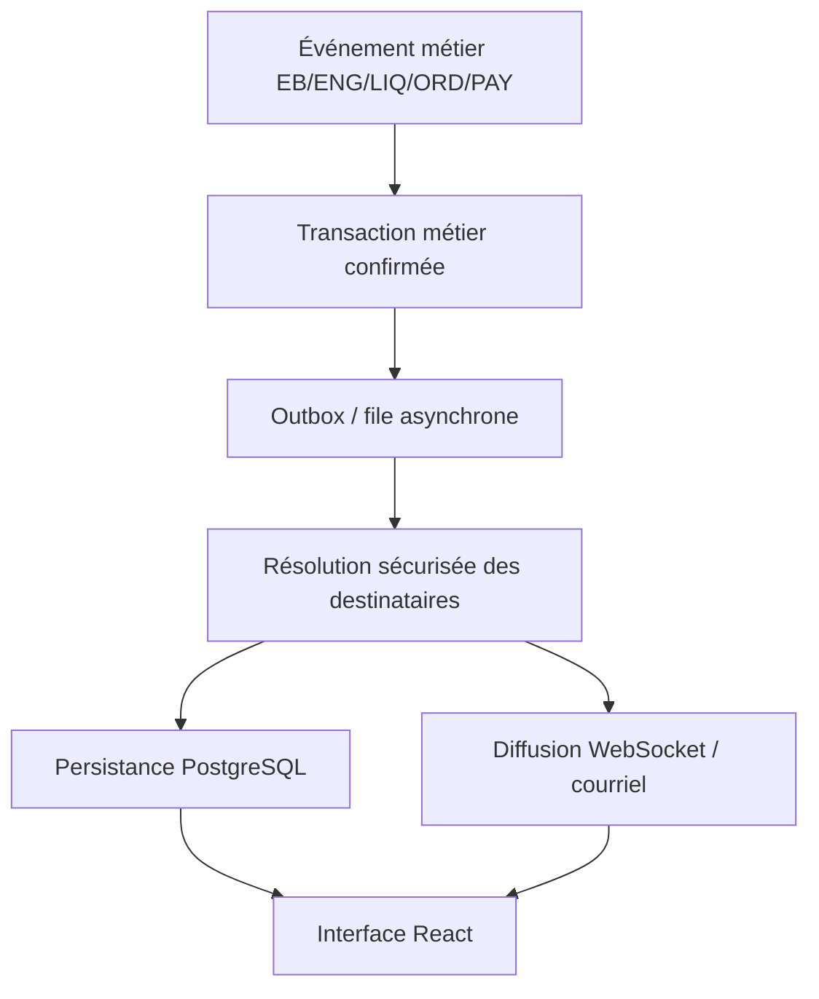

# DESCRIPTION FONCTIONNELLE ET TECHNIQUE DÉTAILLÉE DU MODULE « NOTIFICATIONS »

**Application :** BUDGET-CEEAC / GESBUDEP  
**Institution :** Commission de la CEEAC  
**Version :** 1.0 — 25 octobre 2026  
**Nature :** Spécifications fonctionnelles, techniques, organisationnelles et sécuritaires  
**Périmètre :** Ensemble des modules, circuits de validation et processus institutionnels.

## 1. Présentation générale

### 1.1. Définition

Le module **Notifications** est un système transversal de communication, d'alerte, d'information et de suivi des événements métier générés par les modules de BUDGET-CEEAC/GESBUDEP. Il informe automatiquement les utilisateurs des événements nécessitant leur attention, intervention, validation ou prise de connaissance.

Il contribue à la fluidité des circuits de validation, à la continuité administrative, au respect des délais et à la traçabilité des opérations.

**Modules intégrés :** planification stratégique GAR/RBM, PAP, préparation budgétaire, gestion du budget et des crédits, expressions de besoins (EB), engagements (ENG), liquidations (LIQ), ordonnancements (ORD), paiements (PAY), recettes, suivi-évaluation, GED, utilisateurs/rôles/permissions, administration, journalisation et « Mes Tâches ».

### 1.2. Objectif général

Fournir à chaque utilisateur une interface centralisée, sécurisée, personnalisée et interactive pour recevoir, consulter, traiter et suivre les notifications relevant de ses responsabilités.

### 1.3. Objectifs spécifiques

1. Informer en temps réel ou quasi réel des événements métier.
2. Notifier les acteurs à chaque transition des circuits de validation.
3. Signaler les dossiers exigeant une action.
4. Ouvrir directement le dossier ou la fonction concernée.
5. Alerter sur les retards, anomalies, insuffisances de crédits et blocages.
6. Préserver la confidentialité des informations.
7. Assurer une traçabilité horodatée.
8. Gérer séparément les états lu/non lu et traité/non traité.
9. Organiser les rappels et escalades autorisées.
10. Produire les indicateurs de pilotage.
11. Synchroniser les notifications avec « Mes Tâches ».
12. Réduire les doublons et sollicitations excessives.

## 2. Principes fondamentaux

| Principe | Exigence |
|---|---|
| Automatisation | Création sur événement métier confirmé |
| Temps réel | Diffusion dès confirmation de l'opération |
| Personnalisation | Destinataires selon rôle, affectation, dossier et étape |
| Sécurité | Contrôle backend et cloisonnement organique |
| Traçabilité | Historique horodaté des opérations |
| Interactivité | Ouverture de la ressource précise |
| Cohérence | Actualisation selon l'état réel du dossier |
| Fiabilité | Traitement asynchrone fiable et reprises |
| Non-intrusion | Déduplication et regroupement |
| Accessibilité | Compatibilité ordinateur, tablette et mobile |
| Évolutivité | Nouveaux événements sans refonte majeure |

**Règle majeure :** une notification ne crée jamais, à elle seule, un droit d'accès ni d'exécution. Chaque consultation et chaque action demeurent soumises aux contrôles d'autorisation du backend.

## 3. Typologie des notifications

### 3.1. Informations

Événements ne nécessitant pas nécessairement d'action : budget adopté, activité PAP validée, document mis à disposition, changement de statut, clôture d'exercice.

### 3.2. Actions requises

Événements appelant une intervention : EB à valider, engagement à viser, liquidation à certifier, ordonnancement à signer, paiement à exécuter. Chaque notification ouvre la ressource exacte et, si l'utilisateur y est autorisé, l'action attendue.

### 3.3. Alertes

Insuffisance de crédits, risque de dépassement, retard, dossier bloqué, échéance dépassée, pièce manquante, incohérence ou échec technique.

### 3.4. Validations, rejets et retours

Validation d'EB, visa d'engagement, retour pour correction, rejet de liquidation, signature d'ordonnancement et exécution de paiement.

### 3.5. Rappels et escalades

Relances fondées sur des délais paramétrables, suivies le cas échéant d'une escalade hiérarchique autorisée.

### 3.6. Système et sécurité

Modification sensible de rôle, désactivation de compte, incident de synchronisation, échec d'une tâche critique et autres événements techniques réservés aux destinataires habilités.

## 4. Priorités

| Priorité | Niveau | Usage |
|---|---|---|
| P1 | Critique | Incident majeur ou blocage financier/sécuritaire |
| P2 | Élevée | Échéance proche, visa prioritaire, anomalie bloquante |
| P3 | Normale | Dossier à traiter, changement d'état, transmission |
| P4 | Faible | Information générale et mise à jour documentaire |

Les règles d'affectation de priorité sont configurables, non codées en dur dans le frontend.

## 5. Destinataires et périmètres

### 5.1. Profils

Président, Vice-Présidente, Commissaires, Secrétaire Général, Directeurs, Chefs de service, Experts/agents, Direction du Budget, Contrôleur Financier Central, Agence Comptable Centrale, administrateurs et autres rôles du référentiel organisationnel.

### 5.2. Règles de distribution

Le moteur de résolution des destinataires croise : rôle, affectation organique, niveau hiérarchique, permissions, participation au dossier, étape du workflow, délégations et confidentialité. Les profils transversaux disposent uniquement des vues prévues par leurs habilitations.

### 5.3. Délégations et intérims

Gérer dates de validité, périmètres délégués, titulaires, délégataires, transfert des notifications et expiration automatique. Les habilitations sont toujours vérifiées dans le module de sécurité.

## 6. Intégration à la chaîne de dépense

### 6.1. Expressions de besoins (EB) liées au PAP

| Événement | Destinataire principal |
|---|---|
| Soumission EB | Directeur concerné |
| Validation Directeur | Commissaire du département technique ou SG pour les directions d'appui |
| Rejet/retour pour correction | Initiateur |
| Validation finale | Initiateur et acteurs de l'étape suivante |

### 6.2. Expressions de besoins hors PAP

| Événement | Destinataire principal |
|---|---|
| Soumission | DRHMG |
| Validation DRHMG | Secrétaire Général |
| Validation SG | Président (ordonnateur) |
| Approbation/signature | Initiateur et acteurs d'engagement |
| Rejet/retour | Agent concerné |

L'approbation d'une EB hors PAP entraîne, conformément au workflow existant, la transition automatique vers l'engagement et les notifications appropriées, sans ressaisie.

### 6.3. Engagements (ENG)

| Événement | Destinataire |
|---|---|
| Engagement créé | Direction du Budget |
| Soumission au visa | Contrôleur Financier |
| Visa accordé | Acteurs de liquidation concernés |
| Rejet/retour | Responsable précédent |
| Insuffisance de crédits | Direction du Budget et acteurs habilités |
| Réajustement autorisé | Responsables du dossier |

Une alerte d'insuffisance de crédits doit identifier le dossier et la ligne budgétaire selon les droits de consultation.

### 6.4. Liquidations (LIQ)

| Événement | Destinataire |
|---|---|
| Dossier à certifier | Service initiateur habilité |
| Service fait certifié | Contrôleur Financier |
| Liquidation visée | Acteurs d'ordonnancement |
| Liquidation rejetée | Responsable concerné |
| Pièce manquante | Agent chargé du dossier |

### 6.5. Ordonnancements (ORD)

La compétence de signature repose sur un **seuil paramétrable**, initialement fixé à **5 000 000 FCFA**.

| Montant | Destinataire |
|---|---|
| Inférieur ou égal au seuil | Secrétaire Général |
| Supérieur au seuil | Président de la Commission |

Après signature, notifier l'Agence Comptable et les acteurs autorisés ; mettre à jour les tâches et journaliser l'événement. Le seuil ne doit pas être codé en dur.

### 6.6. Paiements (PAY)

| Événement | Destinataire |
|---|---|
| Ordonnancement prêt au paiement | Agence Comptable |
| Paiement préparé | Responsable habilité |
| Paiement signé | Agents/services concernés |
| Paiement exécuté | Service initiateur et responsables autorisés |
| Paiement partiel | Acteurs concernés |
| Solde restant dû | Agent comptable et acteurs concernés |
| Rejet/échec bancaire | Agence Comptable |

**Paiements partiels :** notifier le montant payé et le solde restant selon les habilitations. Ne jamais déclarer totalement réglé un ordonnancement dont le solde n'est pas apuré.

## 7. Autres modules intégrés

| Module | Événements clés |
|---|---|
| PAP/Planification | Activité créée, affectation, validation, retard, changement de budget |
| Préparation budgétaire | Campagne ouverte, enveloppe transmise, prévision soumise, arbitrage, clôture |
| Suivi-Évaluation | Rapport attendu, indicateur en retard, rapport soumis, correction demandée |
| GED | Document transmis, nouvelle version, approbation, rejet, pièce manquante |
| Administration | Compte créé/désactivé, rôle modifié, délégation révoquée, incident critique |
| Recettes | Opération soumise, contrôlée, validée ou rejetée selon le processus existant |

## 8. Interface utilisateur

### 8.1. Cloche de notifications

Visible après authentification, dans l'en-tête commun : icône Font Awesome 7, compteur non lues, rafraîchissement temps réel, accès au panneau rapide et libellé accessible.

### 8.2. Panneau rapide

Présenter les dernières notifications avec titre, message court, référence, date/heure, priorité, état de lecture et action « Consulter ». Proposer « Tout marquer comme lu » et « Voir toutes les notifications ».

### 8.3. Page « Notifications »

Comprendre une synthèse, une recherche, des filtres, une liste paginée, un volet de détail et des actions individuelles/groupées.

| Filtre | Valeurs |
|---|---|
| Lecture | Toutes / Non lues / Lues |
| Nature | Action / Information / Alerte / Rappel / Système |
| Priorité | Critique / Élevée / Normale / Faible |
| Module | EB, ENG, LIQ, ORD, PAY, PAP, etc. |
| Période | Dates début et fin |
| Action | À traiter / Traitée / Expirée / Annulée |
| Recherche | Référence, titre, contenu autorisé |

**Exigence :** recherche, filtrage et pagination côté serveur.

### 8.4. Actions utilisateur

Consulter, marquer comme lu/non lu, ouvrir le dossier, consulter le contexte, marquer tout comme lu, archiver selon les règles, masquer les notifications obsolètes et modifier les préférences autorisées.

## 9. Notifications cliquables et navigation intelligente

Chaque notification associée à un dossier métier doit ouvrir **le dossier exact et son contexte d'action**, jamais une page générique sans nécessité.

| Notification | Destination attendue |
|---|---|
| EB à valider | Détail EB / validation |
| Engagement à viser | Détail engagement / visa |
| Liquidation à certifier | Détail liquidation / certification |
| Ordonnancement à signer | Détail ordonnancement / signature |
| Paiement à exécuter | Détail paiement |
| Activité PAP en retard | Fiche activité |
| Rapport S&E à examiner | Détail rapport |
| Document GED disponible | Consultation document |

**Au clic :** identifier la notification, vérifier propriétaire et ressource, recalculer les permissions, enregistrer la consultation, marquer comme lue, puis naviguer vers une route interne autorisée.

Une notification obsolète (dossier déjà traité, annulé, passé à une autre étape ou habilitation perdue) demeure consultable selon les politiques applicables mais ne permet pas l'ancienne action.

**La lecture ne vaut jamais traitement métier.**

## 10. Cycle de vie

**Diffusion :** événement confirmé → notification créée → diffusion/mise à disposition → consultation.

**Lecture :** non lue → lue → archivée (facultatif, état par destinataire).

**Action :** en attente → traitée / annulée / expirée.

Les états de lecture et d'action sont indépendants ; une notification lue peut continuer de représenter une action en attente.

## 11. Synchronisation avec « Mes Tâches »

| « Mes Tâches » | « Notifications » |
|---|---|
| Présente le travail à accomplir | Signale un événement ou une action |
| Permet le traitement du dossier | Permet l'accès au bon dossier |
| Suit les échéances métier | Diffuse rappels et alertes |
| Actualise les tâches après décision | Actualise les messages d'action |

**Règles :** à la création d'une tâche, notifier le responsable ; après validation, retirer la tâche de l'acteur précédent, désactiver l'action obsolète et notifier l'étape suivante ; après rejet, créer la correction requise et notifier le bon agent. Les compteurs de tâches et de notifications restent indépendants.

## 12. Architecture technique et temps réel

### 12.1. Stack cible

- **Frontend :** React.js, Vite, Tailwind CSS, Font Awesome 7.
- **Backend :** Laravel 13+.
- **Base de données :** PostgreSQL 18+.
- **Temps réel :** Laravel Broadcasting avec Laravel Reverb ou compatible.
- **Asynchrone :** Laravel Queues.
- **Planification :** Laravel Scheduler.
- **Cache/files :** Redis si retenu dans l'architecture.

### 12.2. Chaîne de traitement



### 12.3. Garanties

Ne jamais annoncer une opération non validée ; publier après commit ; privilégier une outbox transactionnelle pour les événements critiques ; rendre les jobs idempotents ; configurer des tentatives et une gestion des échecs ; conserver l'accès aux notifications persistées même en cas de panne WebSocket.

## 13. Modèle de données

### 13.1. `notifications`

| Champ | Usage |
|---|---|
| `id` | UUID |
| `event_id` | Référence événement source |
| `type` / `category` | Type et catégorie |
| `priority` | Criticité |
| `title` / `message` | Texte |
| `module_code` | Module source |
| `resource_type` / `resource_id` | Dossier lié |
| `action_code` | Action attendue |
| `metadata` | Métadonnées JSONB contrôlées |
| `created_at` | Création |
| `expires_at` / `cancelled_at` | Expiration/annulation |

### 13.2. `notification_recipients`

| Champ | Usage |
|---|---|
| `id` | Identifiant |
| `notification_id` | Notification |
| `user_id` | Destinataire |
| `read_at` | Lecture individuelle |
| `archived_at` | Archivage individuel |
| `delivered_at` | Mise à disposition |
| `action_status` | État de l'action |
| `action_completed_at` | Date de traitement |
| `created_at` | Association |

### 13.3. Structures complémentaires

`notification_preferences`, `notification_templates`, `notification_rules`, `notification_deliveries`, `notification_outbox`, `notification_escalations`.

**Ne pas dupliquer ces tables si le modèle existant suffit.** Prévoir clés étrangères, index, unicité/idempotence, contraintes de statut, politiques de conservation et protection des données.

## 14. Services Laravel et API

### 14.1. Services recommandés

| Service | Fonction |
|---|---|
| `NotificationService` | Gestion centrale |
| `NotificationRecipientResolver` | Résolution des destinataires |
| `NotificationTemplateService` | Modèles de contenus |
| `NotificationDispatchService` | Livraison multicanale |
| `NotificationPreferenceService` | Préférences |
| `NotificationActionResolver` | Destination sûre |
| `NotificationReminderService` | Rappels |
| `NotificationEscalationService` | Escalades |
| `NotificationAuditService` | Traçabilité |

### 14.2. API indicative

| Verbe | Endpoint | Fonction |
|---|---|---|
| GET | `/api/notifications` | Liste paginée |
| GET | `/api/notifications/unread-count` | Compteur |
| GET | `/api/notifications/summary` | Synthèse |
| GET | `/api/notifications/{id}` | Détail |
| PATCH | `/api/notifications/{id}/read` | Marquer lue |
| PATCH | `/api/notifications/{id}/unread` | Marquer non lue |
| PATCH | `/api/notifications/read-all` | Tout marquer lu |
| PATCH | `/api/notifications/{id}/archive` | Archiver |
| GET | `/api/notifications/{id}/destination` | Résolution sécurisée |
| GET | `/api/notification-preferences` | Lire préférences |
| PUT | `/api/notification-preferences` | Modifier préférences |

### 14.3. Exemple de payload

```json
{
  "id": "notification-uuid",
  "type": "workflow.action_required",
  "module": "ENG",
  "priority": "high",
  "title": "Engagement en attente de visa",
  "message": "Un engagement nécessite votre visa.",
  "resource": {
    "type": "engagement",
    "id": "engagement-uuid",
    "reference": "ENG-2026-0042"
  },
  "action": {
    "code": "engagement.viser",
    "available": true
  },
  "read_at": null,
  "created_at": "2026-10-25T14:30:00Z"
}
```

L'exemple ne fixe pas les routes ni le schéma final. La destination est résolue côté serveur par un registre de routes autorisées.

## 15. Sécurité et confidentialité

- Authentification obligatoire et autorisations Laravel Policies/Gates.
- Cloisonnement par service, direction, département et rôle transversal.
- Vérification des permissions à chaque opération, y compris l'ouverture d'un lien.
- Canaux WebSocket privés, abonnements authentifiés.
- Protection contre les accès indirects non autorisés (IDOR).
- Minimisation des données financières et personnelles dans les aperçus.
- Aucun jeton, secret ou élément sensible dans les messages.
- Délégations et révocations appliquées immédiatement selon leur validité.
- Journalisation des modifications de paramétrage et des actes sensibles.

## 16. Journalisation, traçabilité et horodatage

Journaliser création, destinataires, livraison, erreurs, reprises, consultation utile pour l'audit, archivage, annulation, expiration, modification des règles et escalade.

**Attributs :** identifiant d'événement, utilisateur ou service système, horodatage serveur, action, ressource, résultat, identifiant de corrélation et contexte pertinent. Protéger les logs contre les modifications non autorisées. L'archivage d'une notification ne supprime jamais son historique d'audit.

## 17. Délais, rappels et escalades

| Situation | Règle illustrative |
|---|---|
| Nouvelle action | Notification immédiate |
| En attente après 24 h | Premier rappel |
| En attente après 48 h | Deuxième rappel |
| Délai métier dépassé | Alerte de retard |
| Retard important | Escalade selon habilitations |
| Action traitée | Fin des rappels |

**Ces délais sont des exemples, à valider par l'administration fonctionnelle.** Le moteur doit gérer jours ouvrables, fuseaux horaires, absence de doublons, cadence maximale et contrôle du destinataire d'escalade.

## 18. Paramétrage et administration

Une interface protégée doit configurer catégories, déclencheurs, règles de destinataires, modèles, priorités, canaux, délais, escalades, rétention, regroupement et déduplication. Toute modification est versionnée et auditée. L'administration technique ne confère pas automatiquement l'accès aux dossiers métier.

## 19. Préférences utilisateurs

Prévoir courriel, temps réel, fréquence des synthèses, catégories facultatives et options de présentation. Les alertes et notifications institutionnelles obligatoires ne sont pas désactivables par l'utilisateur lorsque leur caractère obligatoire est validé.

## 20. Indicateurs de pilotage

- Volume émis, lu, non lu et archivé.
- Taux de lecture.
- Délai moyen événement → livraison.
- Délai moyen création → première lecture.
- Nombre d'actions encore en attente.
- Alertes critiques actives et notifications expirées.
- Nombre de rappels et d'escalades.
- Échecs de diffusion et taux de reprise.
- Ventilation par module, période et entité organique autorisée.

**Attention :** vitesse de lecture et vitesse de traitement du dossier sont deux mesures distinctes.

## 21. Exigences non fonctionnelles

**Performance :** pagination, filtres serveur, index, prévention des requêtes N+1, queues et montée en charge.  
**Résilience :** stockage persistant, reconnexion, resynchronisation des événements manqués, reprises d'échec.  
**Accessibilité :** navigation clavier, contraste, lecteurs d'écran, états non fondés sur la seule couleur.  
**Ergonomie :** responsive et respect des maquettes existantes.  
**Internationalisation :** textes, dates, montants et conventions institutionnelles.

## 22. Intégration sans destruction de l'existant

### 22.1. Audit avant modification

Inventorier tables, modèles, migrations, événements/listeners, composants React, cloche et compteurs, routes, notifications cliquables, tâches, workflows, permissions, files, logs et tests.

### 22.2. Données et fonctionnalités protégées

Préserver : Budget 2026, nomenclature budgétaire, référentiel organisationnel, utilisateurs, identifiants, mots de passe chiffrés, affectations, rôles, permissions, dossiers et historiques métier, documents et circuits conformes.

Ne jamais effectuer de réinitialisation destructive. Toute migration doit être réversible lorsque techniquement possible, testée et assortie d'un plan de sauvegarde/restauration. Contrôler avant/après les catégories institutionnelles protégées.

### 22.3. Phases

1. Audit et rapport des écarts.
2. Adaptation du modèle de données et migrations sûres.
3. Services backend et moteur d'événements.
4. Intégration complète EB/ENG/LIQ/ORD/PAY.
5. Cloche, panneau rapide et page React.
6. Intégration Mes Tâches, GED, S&E, administration et audit.
7. Tests fonctionnels, sécuritaires, temps réel et non-régression.
8. Déploiement contrôlé, validation et supervision.

## 23. Plan de tests et recette

| ID | Test | Résultat attendu |
|---|---|---|
| NOT-001 | EB créée | Bon validateur notifié |
| NOT-002 | EB validée | Acteur suivant notifié |
| NOT-003 | Engagement rejeté | Retour au responsable habilité |
| NOT-004 | Crédits insuffisants | Alerte ciblée et traçable |
| NOT-005 | LIQ à certifier | Service compétent notifié |
| NOT-006 | ORD ≤ seuil | SG notifié |
| NOT-007 | ORD > seuil | Président notifié |
| NOT-008 | Paiement partiel | Montant et solde cohérents |
| NOT-009 | Clic sur notification | Dossier exact ouvert |
| NOT-010 | Notification lue | Compteur mis à jour |
| NOT-011 | Dossier traité | Action obsolète désactivée |
| NOT-012 | Permission révoquée | Accès refusé |
| NOT-013 | Reconnexion | Notifications manquées récupérées |
| NOT-014 | Échec de diffusion | Réessai journalisé |
| NOT-015 | Événement répété | Pas de doublon logique |
| NOT-016 | Tout marquer lu | Uniquement les notifications du destinataire |
| NOT-017 | Délai dépassé | Rappel/escalade paramétrés |
| NOT-018 | Affectation changée | Nouveau périmètre respecté |
| NOT-019 | Dossier annulé | Ancienne action indisponible |
| NOT-020 | Migration | Données protégées intactes |

**Critères de recette :** bons événements, bons destinataires, liens fonctionnels, contrôles backend, statuts exacts, actions obsolètes bloquées, traitement fiable, audit, idempotence, non-régression et préservation des données.

## 24. Livrables attendus

1. Rapport d'audit et matrice des écarts.
2. Matrice événements/destinataires/permissions.
3. Modèle de données et migrations.
4. Services Laravel, événements, listeners et jobs.
5. Contrôleurs et routes API.
6. Policies/Gates et canaux privés.
7. Interfaces et composants React.
8. Configurations de rappels et diffusion.
9. Tests automatisés backend et frontend.
10. Documentation API/technique.
11. Rapport de recette et non-régression.
12. Historique des corrections.

## 25. Règles métier impératives

- **RN-01 :** notification seulement après confirmation de l'événement métier.
- **RN-02 :** chaque notification a une source identifiable.
- **RN-03 :** chaque notification d'action identifie une ressource précise.
- **RN-04 :** chaque ouverture déclenche un contrôle d'habilitation.
- **RN-05 :** lire n'est pas traiter.
- **RN-06 :** une action obsolète est inexécutable.
- **RN-07 :** destinataires issus des rôles, permissions et affectations réels.
- **RN-08 :** respect du cloisonnement organique.
- **RN-09 :** arrêt des rappels après traitement/annulation.
- **RN-10 :** idempotence et déduplication.
- **RN-11 :** auditabilité des opérations critiques.
- **RN-12 :** panne de diffusion sans perte du dossier métier.
- **RN-13 :** récupération des notifications manquées.
- **RN-14 :** règles paramétrables et versionnées.
- **RN-15 :** préservation intégrale de l'existant conforme.
- **RN-16 :** synchronisation avec Mes Tâches et l'état du dossier.
- **RN-17 :** paiement partiel ≠ paiement total si solde restant.
- **RN-18 :** compétence de signature ORD fondée sur seuil paramétré.
- **RN-19 :** confidentialité du contenu selon destinataire.
- **RN-20 :** conformité à la charte et aux maquettes BUDGET-CEEAC/GESBUDEP.

## 26. Conclusion

Le module **Notifications** doit constituer une infrastructure transversale de pilotage des événements et des actions, pas une simple liste de messages. Sa mise en œuvre doit donner la priorité à la **fiabilité des événements**, à la **sécurité des destinataires**, aux **notifications cliquables** et à la **cohérence avec les workflows**.

La conception recommandée repose sur des services Laravel centralisés, la persistance transactionnelle, la diffusion asynchrone et une interface React conforme aux maquettes existantes.

Les matrices de destinataires, délais, priorités et escalades proposées dans ce référentiel doivent être confrontées aux procédures officielles et aux habilitations réelles de la CEEAC avant mise en production.

---

**Fin du document — Référentiel de spécification du module Notifications BUDGET-CEEAC/GESBUDEP.**
